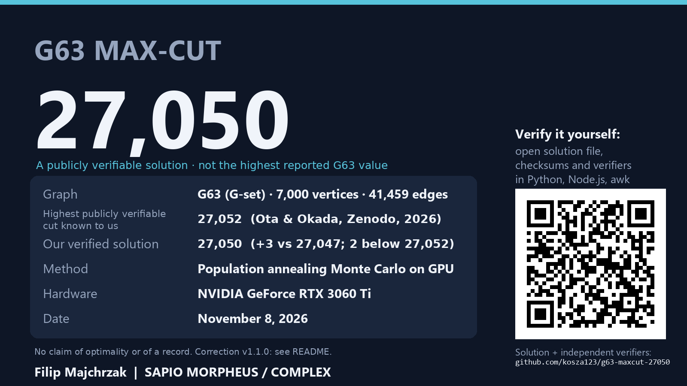

# G63 Max-Cut: a publicly verifiable solution of 27,050

[](https://doi.org/10.5281/zenodo.24049667)

**A publicly verifiable G63 Max-Cut configuration of value 27,050.**

> **Correction (version 1.1.0, November 2026).** Our result of 27,050 does improve upon the cited 27,047 configuration
> (Khan & Shukla), but our original presentation in version 1.0.0 was misleading because we overlooked an earlier, publicly verifiable
> G63 configuration with cut value **27,052**, published by Ota and Okada on 23 March 2026. In particular, the statement that every
> verifiable primary source listed at most 27,047 for G63 was wrong. Researchers have also pointed us to an earlier report of 27,052
> (Fujitsu Digital Annealer, 2020) and a 2026 report of 27,051, which we have not yet been able to verify in the full texts. 27,050 is therefore
> **not** the highest reported value for G63. Details and citations:
> [Status of reported G63 values](#status-of-reported-g63-values).

**Can you verify it?** The full partition is public and checking it takes under a second
(see *Verify it yourself*). If you find an error, or a cut above 27,052, please open an issue.



| | |
|---|---|
| Instance | G63 from the G-set benchmark (7,000 vertices, 41,459 unit-weight edges) |
| Highest publicly verifiable value known to us | **27,052** — Ota & Okada, Zenodo, 23 March 2026 ([doi:10.5281/zenodo.19189885](https://doi.org/10.5281/zenodo.19189885)) |
| Reference used in version 1.0.0 | 27,047 — Khan & Shukla, arXiv:2510.21105 (2025) |
| This solution | **27,050** (+3 edges relative to the 27,047 configuration; 2 below 27,052) |
| Method | Population annealing Monte Carlo on a GPU (a known method; see [METHODOLOGY.md](METHODOLOGY.md)) |
| Hardware | one NVIDIA GeForce RTX 3060 Ti (consumer GPU) |
| Found | 8 November 2026, 02:13:52 CET, 158.5 minutes into a 7-hour experiment |
| Author | Filip Majchrzak — SAPIO MORPHEUS / COMPLEX (independent research project) |

The point of this repository is that you do not have to trust us: the full configuration is here, together with three
short, dependency-free verifiers. Checking the cut takes less than a second.

## Verify it yourself

1. Download the original instance from the G-set page: `https://web.stanford.edu/~yyye/yyye/Gset/G63`
   (expected sha256 `a1d08e1eed7a32c480e1e71b106c96c6ee280fda1bc7314a33651a8cf493a99b`).
2. Run any of the verifiers:

```bash
python3 verify/verify_cut.py G63 solution/G63_maxcut_27050.txt
node verify/verify_cut.js G63 solution/G63_maxcut_27050.txt
awk -f verify/verify_cut.awk solution/G63_maxcut_27050.txt G63
```

Each verifier reports 27050 on its `CUT` line (Python/Node.js: `CUT              : 27050`; awk: `CUT 27050`). As a control,
the published 27,047 configuration (hexadecimal string in arXiv:2510.21105, read most significant bit first) gives 27,047 with
`python3 verify/verify_cut.py G63 <hexfile> --hex`.

## Files

- `solution/G63_maxcut_27050.txt` — 7,000 characters `0`/`1`; character *k* is the side of vertex *k*+1 (G-set numbering).
- `solution/G63_maxcut_27050.hex` — the same partition as 1,750 hexadecimal digits, each digit read most significant bit first (the hexadecimal format used in arXiv:2510.21105; reading their string this way reproduces 27,047).
- `solution/SHA256SUMS` — checksums of the solution files, of the 1,092-vertex list, and of the original G63 file (last line; the G63 file itself is not in this repository — save your download as `G63` in the repository root and run `sha256sum -c solution/SHA256SUMS` from the root to check all four).
- `verify/` — independent verifiers in Python, Node.js and awk.
- `results/VERIFICATION.md` — all checks performed and their outputs.
- `results/STRUCTURE.md` — how the solution differs from the published 27,047 configuration (one connected 1,092-vertex domain, +3).
- `METHODOLOGY.md` — algorithm, parameters, hardware, timing, statistics, limitations and AI-use statement.
- `paper/` — LaTeX source of the accompanying preprint (not yet submitted).
- `CITATION.cff`, `.zenodo.json` — citation metadata.

## What we claim — and what we do not

- We claim a **verifiable configuration** with cut value 27,050 on G63. It exceeds the 27,047 configuration of Khan & Shukla,
  but it is **not** the highest reported or the highest publicly verifiable value for G63 (see below).
- We do **not** claim that 27,050 is optimal, and we do not claim a new algorithm: population annealing is a known method.
- The 27,050 configuration was found on 8 November 2026 from random initial states, before we were aware of the 27,052 reports,
  and without using any 27,052 configuration.

## Status of reported G63 values

Reported values of at least 27,045 that we know of, in chronological order. As far as we know, configurations are public only for 27,047,
27,050 and the 27,052 of Ota & Okada. Rows marked *not verified by us* rest on pointers from other researchers.

| Value | Source | Configuration public? |
|---|---|---|
| 27,045 | Global equilibrium search: V. P. Shylo, F. Glover, I. V. Sergienko, *Cybernetics and Systems Analysis* 51(1):16–24, 2015, [doi:10.1007/s10559-015-9692-2](https://doi.org/10.1007/s10559-015-9692-2) (as credited in arXiv:2510.21105) | not known to us |
| 27,052 (*not verified by us*) | Fujitsu Digital Annealer: S. Matsubara *et al.*, ASP-DAC 2020, pp. 667–672, [doi:10.1109/ASP-DAC47756.2020.9045100](https://doi.org/10.1109/ASP-DAC47756.2020.9045100); K. Takemoto *et al.*, IEICE Trans. Electron. (Japanese ed.) J104-C(4):101–109, 2021, [doi:10.14923/transelej.2020jci0010](https://doi.org/10.14923/transelej.2020jci0010) — see note | none known |
| 27,047 | N. Khan, N. Shukla, arXiv:2510.21105 (October 2025); also listed in N. Khan, R. Redding, N. Shukla, arXiv:2606.25203 (June 2026) | yes |
| 27,052 | R. Ota, M. Okada, *An Explicit Public Certificate for G63 with Cut Value 27,052*, Zenodo, 23 March 2026, [doi:10.5281/zenodo.19189885](https://doi.org/10.5281/zenodo.19189885) | **yes** — highest publicly verifiable value known to us |
| 27,051 (*not verified by us*) | H. Ju, J. Seol, S. Choi, S. Hong, *Hardware Acceleration of Probabilistic Computing for Max-Cut Problems*, IEEE Access 14:132813–132824, 2026, [doi:10.1109/ACCESS.2026.3727846](https://doi.org/10.1109/ACCESS.2026.3727846) — see note | not known to us |
| 27,050 | this record (8 November 2026) | yes |

Note: the Fujitsu 27,052 reports and the 27,051 report were pointed out to us by Kenneth Zick (USC Information Sciences Institute)
and Nikhil Shukla (University of Virginia). We have not yet read these values in the full texts ourselves (the IEEE Access paper is open access, but our
automated tools could not retrieve it); the bibliographic data above are checked, the G63 values are not. The 27,052 of Ota & Okada
is checked against their published Zenodo record (value and assignment as given by the authors; we have not recomputed it).
We thank both for their help in describing this result accurately.

## Use of AI

The experiment was conceived and directed by Filip Majchrzak. The search code, the execution of the experiment, the
verification tools and the first drafts of the documentation were produced with the AI assistant Claude (Anthropic) acting as
research operator under his direction; three recounts were written by separate AI-agent instances without access to the search
code. See [METHODOLOGY.md](METHODOLOGY.md).

## Citation

If you use this result, please cite the archived record:

> Majchrzak, F. (2026). *G63 Max-Cut: a publicly verifiable solution of 27,050* [Data set]. Zenodo.
> https://doi.org/10.5281/zenodo.24049667

The DOI above covers all versions and always resolves to the latest one. To cite a specific version, use its own DOI from the
Zenodo record page. Version 1.0.0 (https://doi.org/10.5281/zenodo.24049668) contains the incorrect
statement about other reports that is corrected in version 1.1.0.
GitHub's "Cite this repository" uses `CITATION.cff`.

## Contact

Filip Majchrzak — GitHub [@kosza123](https://github.com/kosza123). Independent re-verification and comparisons with other
methods are very welcome (please open an issue).

## License

Data and documentation: CC BY 4.0 (`LICENSE`). Verifier code: MIT (`LICENSE-CODE`).
